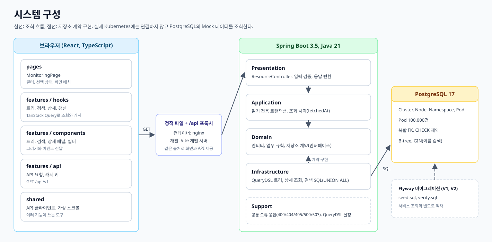
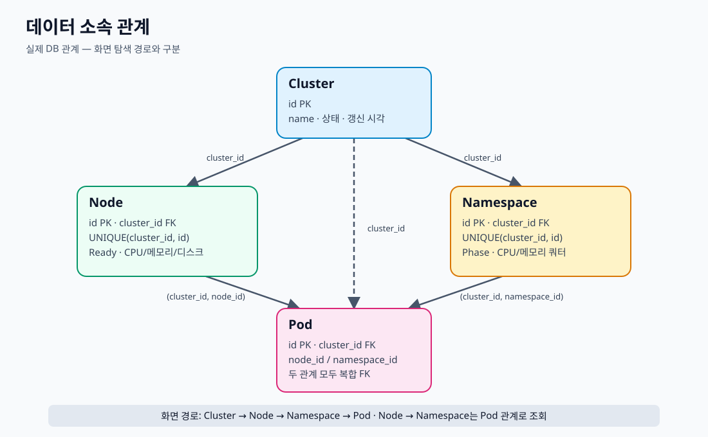

# Infrastructure Monitoring Service

Kubernetes 리소스(Cluster → Node → Namespace → Pod)를 트리로 탐색하고 상태를 확인하는 모니터링 서비스입니다.

- 실제 Kubernetes에는 연결하지 않습니다.
- PostgreSQL에 넣은 Mock 데이터를 조회합니다. (Cluster 20, Node 200, Namespace 2,000, Pod 100,000)

---

## 1. 프로젝트 실행 방법

### 컨테이너로 실행 (Docker만 필요)

1. 서비스를 띄웁니다.

   ```sh
   docker compose up -d --build --wait
   ```

2. Mock 데이터를 넣고 확인합니다.

   ```sh
   docker compose exec -T db psql -U monitoring -d monitoring -1 -f /dev/stdin < scripts/seed.sql
   docker compose exec -T db psql -U monitoring -d monitoring -f /dev/stdin < scripts/verify.sql
   ```

3. 브라우저에서 `http://localhost:3000`을 엽니다.

- API: `http://localhost:8080/api/v1`
- 상태 확인: `http://localhost:8080/actuator/health`
- 포트가 겹치면 `DB_PORT`, `BACKEND_PORT`, `FRONTEND_PORT`로 바꿉니다.

### 로컬 개발 실행 (Java 21, Node.js 필요)

1. DB만 띄웁니다: `docker compose up -d --wait db`
2. 백엔드를 실행합니다: `cd backend && ./gradlew bootRun` (시작할 때 Flyway가 스키마를 만듭니다)
3. 처음 한 번 위의 2번 명령으로 Mock 데이터를 넣습니다.
4. 화면을 실행합니다: `cd frontend && npm ci && npm run dev`
5. 브라우저에서 `http://localhost:5173`을 엽니다.

### 테스트

- 백엔드: `cd backend && ./gradlew test`
  - 실제 PostgreSQL의 테스트 DB(`monitoring_test`)를 씁니다. DB 컨테이너가 처음 뜰 때 만들어집니다.
  - 처음 한 번은 스키마를 만든 뒤 테스트 DB에도 Mock 데이터를 넣습니다. (CI와 같은 순서)

    ```sh
    cd backend && ./gradlew test --tests com.ocs.monitoring.MonitoringApplicationTests && cd ..
    docker compose exec -T db psql -U monitoring -d monitoring_test -1 -f /dev/stdin < scripts/seed.sql
    ```

- 프론트: `cd frontend && npm test`
- E2E: 격리 환경을 띄워 실행하고, 끝나면 내립니다.

  ```sh
  scripts/e2e/env.sh up
  (cd frontend && E2E_BASE_URL=http://localhost:13100 E2E_DB_CONTAINER=monitoring-e2e-db-1 npm run test:e2e)
  scripts/e2e/env.sh down
  ```

---

## 2. 사용한 기술 및 선택 이유

- **백엔드:** Java 21, Spring Boot 3.5
  - 입력 검증, 읽기 전용 트랜잭션, 전역 예외 처리를 계층마다 나눠 둘 수 있습니다.
- **조회:** JPA + QueryDSL, 통합 검색만 네이티브 SQL
  - 필터가 붙을 때만 `EXISTS` 조건이 달라지는 동적 쿼리를 문자열이 아니라 타입 안전한 코드로 조합합니다.
  - 통합 검색은 네 종류를 한 순서로 정렬하고 페이지를 나눠야 합니다. JPQL은 `UNION`을 지원하지 않아 이것만 SQL로 둡니다.
- **DB:** PostgreSQL 17, Flyway
  - 복합 FK로 Pod가 같은 Cluster의 Node, Namespace만 가리키도록 DB가 막습니다.
  - `pg_trgm` GIN 인덱스로 이름 부분 검색을 인덱스로 처리합니다.
  - 스키마와 인덱스 변경은 Flyway 버전으로 남기고, JPA는 매핑 검증(`validate`)만 합니다.
- **프론트:** React 19, TypeScript, Vite
  - 응답 타입을 API 계약과 같은 모양으로 두어 계약이 어긋나면 빌드에서 잡습니다.
- **서버 상태:** TanStack Query 5
  - 캐시 키가 다르면 다른 캐시라서 늦게 온 예전 응답이 현재 화면을 덮지 않습니다.
  - 실패해도 마지막 성공 데이터가 남고, 요청 취소와 중복 제거를 라이브러리가 맡습니다.
  - 직접 구현했을 때 생긴 결함(늦은 응답 덮어쓰기, 실패 뒤 버튼 잠김)을 없애려고 도입했습니다.
- **가상 스크롤:** 직접 구현 (`useVirtualWindow`)
  - 행 높이가 38px로 고정이라 보이는 범위 계산만 하면 됩니다.
- **실행:** Docker Compose, nginx
  - 명령 하나로 DB, API, 화면을 띄웁니다.
  - nginx가 정적 파일과 `/api`를 같은 출처로 묶어 CORS 설정이 필요 없습니다.
- **검증:** JUnit + 실제 PostgreSQL, Vitest + MSW, Playwright, k6, GitHub Actions
  - CI는 Mock 데이터 10만 건을 넣은 DB로 백엔드 테스트를 돌리고 이미지까지 빌드합니다.

- 자세한 내용
  - [설계 결정 기록](docs/design/02-adr.md): 기술마다 검토한 선택지와 비용

---

## 3. 프로젝트 구조



- 백엔드 의존 방향: `presentation → application → domain ← infrastructure`
  - Domain은 HTTP와 JPA 구현을 모릅니다. 저장소는 Domain에 계약만 두고 Infrastructure가 구현합니다.
- 프론트 의존 방향: `app → pages → features → shared`

```text
backend/                          Spring Boot API
├── src/main/java/com/ocs/monitoring/
│   ├── presentation/             HTTP 입력 검증, 응답 변환 (Controller)
│   ├── application/              읽기 전용 트랜잭션, 조회 시각
│   ├── domain/                   엔티티, 업무 규칙, 저장소 계약
│   ├── infrastructure/           JPA, QueryDSL, 검색 SQL
│   └── support/                  공통 오류 응답, 설정
├── src/main/resources/db/migration/   Flyway 스키마
└── src/test/                     단위, 통합 테스트
frontend/                         React 화면
├── src/
│   ├── app/                      화면 진입, 조회 캐시 설정
│   ├── pages/                    화면 배치, 필터와 선택 상태
│   ├── features/resource-explorer/
│   │   ├── api/                  API 요청, 캐시 키, 조회 정의
│   │   ├── hooks/                트리, 검색, 상세, 갱신 로직
│   │   ├── components/           트리, 검색, 상세 패널, 필터
│   │   └── utils/                트리 행 계산, 필터 일치 판단
│   └── shared/                   공통 도구 (API 클라이언트, 가상 스크롤)
├── tests/                        단위, 컴포넌트, E2E 테스트
└── nginx.conf                    정적 파일 제공, /api 프록시
scripts/
├── seed.sql, verify.sql          Mock 데이터 적재, 검증
├── e2e/                          E2E, 성능 측정용 격리 환경
└── k6/, perf/                    API 부하, 화면 성능 측정
docs/
├── design/                       요구사항, 설계 결정, 데이터 모델, API 명세, 아키텍처, 테스트 시나리오, 작업 계획
├── report/                       기능 테스트, 화면 성능, API/DB 성능 결과
└── ai-log/                       브랜치별 작업 기록
docker-compose.yml                DB, 백엔드, 화면 서비스
.github/workflows/                CI (테스트, 이미지 빌드)
```

- 자세한 내용
  - [아키텍처](docs/design/05-architecture.md): 시스템 경계, 구성 요소의 책임, 계층 의존 방향
  - [Backend 규칙](backend/AGENTS.md): 백엔드 계층별 역할과 조회, 오류 처리 규칙
  - [Frontend 규칙](frontend/AGENTS.md): 프론트 폴더별 역할과 상태, 요청 규칙

---

## 4. 구현한 기능

- **트리 탐색**
  - 첫 화면은 Cluster만 읽고, 펼칠 때 바로 아래 한 단계만 읽습니다.
  - 펼침 버튼과 이름 선택을 나눠, 펼쳐도 선택이 바뀌지 않습니다.
- **상세 확인**
  - 리소스를 고르면 오른쪽 패널에 상태, 심각도, 종류별 속성, 탐색 경로를 보여 줍니다.
  - 여러 Node에 걸친 Namespace는 트리에서 클릭한 Node 경로로 엽니다.
- **전체 검색**
  - 펼치지 않은 분기까지 네 종류의 이름을 DB에서 찾고, 20건씩 더 받습니다.
  - 결과를 고르면 필요한 분기만 열고 그 행을 선택합니다.
- **상태 필터**
  - 과제의 "상태" 필터를 이상 심각도(NONE, WARNING, ERROR, UNKNOWN)로 구현했습니다.
  - 리소스 고유 상태(`Running`, `Ready` 등)와는 따로 둡니다.
  - 트리와 검색에 함께 적용하고, 검색어와는 AND입니다.
- **데이터 갱신**
  - 30초 폴링과 새로고침 버튼으로 화면에서 쓰는 조회만 다시 읽습니다.
  - 갱신해도 검색어, 필터, 펼침, 선택을 유지합니다.
- **화면 상태**
  - 트리 분기, 검색, 상세마다 로딩, 오류, 빈 결과를 따로 보여 줍니다.

### 추가한 기능과 이유

- **변경 시각과 조회 시각 분리:** 방금 읽은 오래된 상태를 새 상태로 착각하지 않게 합니다. (6-4)
- **경로 표시(PATH)와 범례:** 오류 Pod로 가는 부모를 오류로 오해하지 않게 합니다. (6-4)
- **필터 불일치 안내:** 갱신이나 필터 변경으로 고른 리소스가 필터에서 빠져도 상세를 유지하고 알려 줍니다.
- **실패 시 이전 데이터 유지:** 실패한 영역에만 오류와 재시도를 보여 주고, 다른 영역과 이전 데이터는 그대로 둡니다.
- **스크롤 중 폴링 연기:** 스크롤하는 동안 화면이 끊기지 않습니다. (6-1)
- **검색 결과 행으로 자동 스크롤:** 검색으로 연 행이 화면 밖이면 가운데로 가져옵니다.
- **창 크기에 맞춘 배치:** 넓은 화면에서는 상세 패널이 옆 칸으로, 좁은 화면에서는 본문 위에 덮입니다.

---

## 5. 구현 과정에서 고려한 사항

6번의 설계 판단 외에, 작업 전체에 적용한 기준입니다.

- **요구사항을 먼저 문서로 고정했습니다.**
  - 요구사항 → ADR → 데이터 모델 → API 명세 → 테스트 시나리오 → 작업 계획 순서로 쓰고, 작업 계획의 체크박스 단위로 구현했습니다.
  - 과제와 다르게 해석한 곳은 요구사항 문서에 과제 원문과 대조해 두었습니다.
- **용어 하나에는 뜻 하나만 둡니다.**
  - 자식이 오류여도 부모의 고유 상태와 심각도는 바꾸지 않습니다.
  - `UNKNOWN`은 "상태를 알 수 없음"이고, "데이터가 오래됨"의 뜻으로 쓰지 않습니다.
  - 근거 없는 "오래된 데이터" 시간 기준은 두지 않고, 두 시각을 보여 줘 운영자가 판단하게 했습니다.
- **실패해도 화면은 유지합니다.**
  - 트리 분기, 검색, 상세가 따로 실패하고 따로 다시 시도합니다.
- **측정한 뒤에만 고칩니다.**
  - 스크롤 중 폴링 연기, 검색 인덱스, 10만 행 메모리 개선은 같은 조건의 전후 측정으로 확인한 뒤 넣었습니다.
  - 효과가 없던 시도(프레임 단위 알림 묶기 등)는 되돌렸습니다.
- **실행한 테스트로만 완료를 판단합니다.**
  - 테스트 시나리오마다 ID를 두고, 실제 PostgreSQL 통합 테스트, 컴포넌트 테스트, 격리 환경 E2E로 확인했습니다.

- 자세한 내용
  - [요구사항](docs/design/01-requirements.md): 코드 정의와 과제 기준과의 대조
  - [작업 계획](docs/design/07-work-plan.md): 체크박스 단위의 작업 순서와 완료 조건
  - [테스트 시나리오](docs/design/06-test-scenarios.md): 시나리오별 지키는 위험과 확인 방법

---

## 6. 설계 문서 필수 포함 항목

항목마다 핵심 판단은 "문제 상황 → 검토한 방식 → 선택 이유 → 구현 방식 → 효과와 한계"로, 나머지는 한 줄로 적었습니다. 대안 비교와 비용은 [ADR](docs/design/02-adr.md)에 있습니다.

### 6-1. 프론트엔드 렌더링 전략

데이터를 가져오는 비용, 화면에 그리는 비용, 받은 데이터를 관리하고 갱신하는 비용을 줄이는 데 집중했습니다.

#### 지연 조회와 가상 스크롤

- **문제 상황:** Pod 10만 건을 한 번에 받고 그리면 조회, 전송, 메모리, DOM 비용이 모두 커집니다.
- **검토한 방식:** 전체 목록을 받아 브라우저에서 트리, 검색, 필터를 처리하는 방식
- **선택 이유:** 운영자는 한 번에 일부 분기만 보고, 한 화면에 보이는 행은 수십 개뿐입니다.
- **구현 방식**
  - 첫 화면은 Cluster 20개만, 펼칠 때 바로 아래 한 단계만 받습니다. 받은 목록은 캐시해 다시 펼치면 요청이 없습니다.
  - 38px 고정 행의 가상 스크롤로, 보이는 행과 앞뒤 6행만 그립니다.
- **효과와 한계**
  - 첫 화면 165-353ms. 102,220행을 펼쳐도 DOM 행 수는 화면 높이만큼입니다.
  - 펼칠 때마다 요청이 한 번씩 나가고, 높이가 내용에 따라 달라지는 행은 담을 수 없습니다.

#### 화면 근처 분기만 관찰

- **문제 상황:** 102,220행을 모두 펼쳐 재 보니 탭 메모리 3.3-4.0GB, 클릭 반응 30초였습니다.
  - DOM은 적었고, 30초 할당 38.8GB 중 37GB가 `useQueries`의 결과 추적이었습니다.
- **검토한 방식:** 펼친 분기를 모두 관찰하고 갱신하는 기존 방식
- **선택 이유:** 화면 밖 분기는 행을 만들 데이터만 있으면 됩니다. 보관 범위와 관찰, 갱신 범위를 나눴습니다.
- **구현 방식:** 화면 근처 분기만 관찰, 갱신하고, 읽는 값만 추적하며(`notifyOnChangeProps`), 바뀌지 않은 분기의 행은 재사용합니다.
- **효과와 한계**
  - 탭 메모리 138-183MB, 가만히 둘 때 CPU 268% → 0%
  - 화면 밖 분기는 다음 폴링까지 최대 30초 늦고, 펼침 첫 클릭은 64-152ms로 100ms를 넘을 때가 있습니다.

#### 그 밖의 선택

- **TanStack Query:** 직접 관리할 때 늦은 응답이 현재 결과를 덮었습니다. 결과를 바꾸는 값을 모두 캐시 키에 넣어 조건별로 캐시를 나눴습니다. ([ADR-005](docs/design/02-adr.md))
- **30초 폴링:** 변경 이벤트를 만들 수집기가 없어, SSE나 WebSocket 대신 기존 조회 API를 다시 부릅니다. ([ADR-002](docs/design/02-adr.md))
- **스크롤 중 폴링 연기:** 스크롤과 폴링이 겹쳐 16fps까지 떨어져, 스크롤이 멈추고 1초 뒤로 미뤘습니다. (60fps) ([ADR-002](docs/design/02-adr.md))

- 자세한 내용
  - [ADR-013](docs/design/02-adr.md): 화면 근처 분기만 관찰하는 방식과 비용
  - [브라우저 성능 측정](docs/report/02-browser-performance.md): 폴링 연기와 10만 행 개선의 전후 수치

### 6-2. 계층 데이터 모델링



#### 리소스별 독립 테이블

- **문제 상황:** 과제의 화면 계층과 실제 Kubernetes 소속이 다릅니다. Namespace는 Node가 아니라 Cluster에 속하고, 같은 Namespace의 Pod가 여러 Node에서 실행됩니다.
- **검토한 방식:** 단일 `resources` 테이블 + `parent_id`, 화면 순서대로 테이블 잇기
- **선택 이유:** 부모가 하나인 구조로는 Namespace를 Node마다 중복 저장해야 합니다. 리소스마다 속성과 제약도 다릅니다.
- **구현 방식:** 네 종류를 각각 테이블로 두고, Node와 Namespace 사이에는 직접 관계를 두지 않습니다. Node 아래 Namespace는 그 Node의 Pod로 찾습니다.
- **효과와 한계**
  - 같은 Namespace가 화면의 여러 경로에 나와도 DB에는 하나입니다.
  - 새 리소스 종류가 생기면 테이블과 조회 로직을 추가해야 합니다. 종류가 정해진 과제라 확장성보다 정합성을 우선했습니다.

#### 복합 외래키

- **문제 상황:** 일반 외래키는 Pod가 가리키는 Node가 있는지만 보고, 같은 Cluster인지는 보지 못합니다.
- **검토한 방식:** 애플리케이션에서 검증
- **선택 이유:** 검증이 빠지거나 다른 경로로 데이터가 들어와도 DB가 막게 하고 싶었습니다.
- **구현 방식:** Pod에 `(cluster_id, node_id)`, `(cluster_id, namespace_id)` 복합 외래키를 둡니다.
- **효과와 한계:** 다른 Cluster 조합은 DB가 거부합니다. 대신 Pod에 `cluster_id`가 중복됩니다.

- 자세한 내용
  - [ADR-001](docs/design/02-adr.md): 세 가지 모델의 비교와 화면 영향
  - [데이터 모델](docs/design/03-data-model.md): 테이블, 컬럼, 제약, 인덱스

### 6-3. 인덱스 및 쿼리 전략

트리 조회, 상태 필터, 전체 검색은 목적이 달라 각각에 맞는 쿼리와 인덱스를 골랐습니다.

#### pg_trgm GIN 인덱스 — 부분 문자열 검색

- **문제 상황:** 이름 중간의 글자도 찾아야 합니다. B-tree는 `LIKE '%api%'`처럼 앞에 와일드카드가 붙으면 범위를 좁히지 못해, Pod 10만 건을 순차 스캔했습니다.
- **검토한 방식:** 순차 스캔 유지
- **선택 이유:** 세 글자 단위로 색인하면, 검색어를 포함할 수 있는 후보만 먼저 찾고 실제 조건을 확인합니다.
- **구현 방식:** Namespace, Pod의 `lower(name)`에 GIN을 둡니다. Cluster 20건, Node 200건은 작아서 두지 않았습니다.
- **효과와 한계**
  - 3자 검색 API p95 20.7ms → 5.2ms
  - 저장 공간과 쓰기 비용이 늘고, 1-2자 검색은 개선되지 않습니다. (`q=a` p95 28ms)

#### 그 밖의 선택

- **B-tree 복합 인덱스:** 부모 조건을 앞, 이름과 ID를 뒤에 둬 찾기와 정렬을 한 인덱스로 처리합니다. Pod 목록 0.01-0.02ms ([ADR-009](docs/design/02-adr.md))
- **`EXISTS` 필터:** 하위에 일치가 "하나라도 있는가"만 보고 첫 일치에서 멈춥니다. ERROR 필터 Cluster 약 1.4ms ([ADR-009](docs/design/02-adr.md))
- **QueryDSL:** 필터마다 달라지는 조건을 SQL 문자열 대신 타입 안전한 코드로 조합합니다. ([ADR-004](docs/design/02-adr.md))
- **`UNION ALL` 검색:** 네 종류를 DB에서 합쳐 정렬하고 필요한 페이지만 가져옵니다. JPQL이 `UNION`을 지원하지 않아 이것만 네이티브 SQL입니다. ([ADR-004](docs/design/02-adr.md))
- **`COUNT` 없는 페이징:** 21건을 읽어 21번째가 있으면 다음 페이지가 있다고 봅니다. OFFSET 방식이라 뒤쪽 페이지는 느려질 수 있습니다. ([ADR-010](docs/design/02-adr.md))

- 자세한 내용
  - [ADR-003](docs/design/02-adr.md): GIN 인덱스를 고른 이유와 비용
  - [API/DB 성능 측정](docs/report/03-server-performance.md): 실행계획, 인덱스 전후 비교, 부하 측정

### 6-4. API 설계

모든 API는 `/api/v1` 아래 GET이고, 상태를 바꾸는 API는 없습니다.

```text
/clusters                                        Cluster 목록
/clusters/{clusterId}/nodes                      Node 목록
/nodes/{nodeId}/namespaces                       Node 아래 Namespace 목록
/nodes/{nodeId}/namespaces/{namespaceId}/pods    Pod 목록
/resources/search?q=&page=                       이름 검색 (20건씩)
/resources/{resourceType}/{resourceId}           상세 (Namespace는 ?nodeId=)
```

#### Node 기준 경로 — 탐색 경로 유지

- **문제 상황:** 같은 Namespace가 여러 Node 아래에 나옵니다. Namespace ID만으로 Pod를 조회하면 다른 Node의 Pod까지 섞입니다.
- **검토한 방식:** Namespace ID만 받는 경로 (`/namespaces/{id}/pods`)
- **선택 이유:** 리소스의 고유 ID와, 사용자가 지금 지나온 경로를 구분해야 합니다.
- **구현 방식:** Namespace와 Pod 목록은 `/nodes/{nodeId}/...` 경로로, Namespace 상세는 `nodeId`를 함께 받습니다. 경로 없이 열면 Pod가 있는 최소 ID Node를 씁니다.
- **효과와 한계**
  - 트리에서 고른 Node 아래의 것만 보이고, 상세 경로도 클릭한 경로와 같습니다.
  - 대표 Node를 찾는 비용 때문에 `ns-`처럼 Namespace가 많이 걸리는 검색이 느립니다. (p95 113ms)

#### MATCH와 PATH — 실제 장애와 탐색 경로 구분

- **문제 상황:** ERROR 필터에서 장애 리소스만 보이면 경로가 사라지고, 부모까지 ERROR로 표시하면 부모에 문제가 있다고 오해합니다.
- **검토한 방식:** 하위 장애를 부모 심각도에 반영하는 방식
- **선택 이유:** 리소스 자체의 심각도와, 필터 결과에 나타난 이유는 다른 정보입니다.
- **구현 방식:** 자기 일치는 `MATCH`, 일치하는 하위로 가는 부모는 `PATH`를 붙입니다. 필터가 없으면 `matchRole` 필드를 뺍니다.
- **효과와 한계:** 부모의 심각도는 그대로입니다. 대신 PATH를 판단하려면 하위 `EXISTS`가 필요합니다.

#### 그 밖의 선택

- **단계별 API:** 트리, 검색, 상세가 필요한 범위만큼만 돌려줍니다. 목록에는 상세 속성을 넣지 않습니다.
- **두 시각 분리:** `lastUpdatedAt`(리소스 변경)과 `fetchedAt`(서버 조회 성공)을 나눠, 오래된 상태를 방금 읽은 경우를 구분합니다. ([ADR-012](docs/design/02-adr.md))
- **공통 오류 응답:** 하위가 없으면 빈 목록, 없는 리소스나 경로는 404입니다. 오류는 모두 `{code, message}`이고 내부 정보는 넣지 않습니다. ([ADR-012](docs/design/02-adr.md))

- 자세한 내용
  - [ADR-011](docs/design/02-adr.md): Node 기준 경로를 고른 이유와 비용
  - [ADR-012](docs/design/02-adr.md): MATCH/PATH, 두 시각, 오류 응답을 나눈 이유와 비용
  - [API 명세](docs/design/04-api-spec.md): 경로별 용도, 입력 규칙, 응답 예시, 오류 코드
  - [OpenAPI](docs/design/openapi.yaml): 필드 타입까지 담은 API 계약

---

## 7. 성능 측정 결과

조건: Chrome, CPU 4배 감속, 캐시 끔, 빌드한 이미지, 격리 환경

| 항목 | 목표 | 결과 |
| --- | --- | --- |
| 첫 화면 (Cluster 표시, 조작 가능) | 500ms | 165-353ms |
| 트리 펼침 / 접힘 (102,220행) | 100ms | 40-88ms, 페이지 첫 클릭만 64-152ms |
| 검색 결과 표시 | 300ms | 43-61ms |
| 필터 반영 | 200ms | 51-99ms |
| 대량 목록 스크롤 (102,220행) | 55fps | 59.6-60fps |
| 갱신 반영 | 200ms | 분기 1개 26-32ms, 102,220행 새로고침 53-66ms |
| 탭 메모리 (작업관리자, 102,220행) | 300MB | 138-183MB |

- **목표를 넘는 항목**
  - 펼침의 페이지 첫 클릭이 64-152ms로 100ms를 넘을 때가 있습니다. 두 번째 클릭부터는 목표 안입니다.
  - 원인은 아직 분석하지 못했습니다. 첫 클릭에서 무엇이 오래 걸리는지 프로파일링해 줄이려고 합니다.
- **기타**
  - Lighthouse: 성능, 접근성, 권장사항, SEO 모두 100
  - API 부하(k6, 5명 동시, 20초): 1,330건 요청, 실패 0%, p95 8.5ms
- 자세한 내용
  - [브라우저 성능 측정](docs/report/02-browser-performance.md): 화면 성능 목표 7개의 측정 조건과 결과, 10만 행 개선 과정
  - [API/DB 성능 측정](docs/report/03-server-performance.md): 10만 건 환경의 API 부하와 SQL 실행계획
  - [기능 테스트 결과](docs/report/01-test-results.md): 시나리오별 확인 결과와 CI 실행 기록

---

## 8. 아쉬운 점 및 개선하고 싶은 부분

- **폴링 대신 변경 이벤트로 갱신하기 (SSE)**
  - 현재: 변경 이벤트를 만들 수집기가 없어 30초 폴링을 택했습니다. 바뀐 것이 없어도 화면의 조회를 다시 부르고, 변경은 최대 30초 늦게 보입니다.
  - 개선 방향: 실제 Kubernetes와 연동해 수집기가 변경을 감지하면, 서버가 바뀐 리소스만 SSE로 보내는 방식으로 바꾸고 싶습니다. 요청 수는 줄고 변경은 바로 보입니다. 연결이 끊겼을 때를 대비해 폴링은 보조로 남깁니다.
- **부모에 하위 상태 개수 보여 주기**
  - 현재: 부모는 자기 심각도만 보여 주고, 아래에 장애가 몇 개인지는 필터를 켜고 펼쳐야 알 수 있습니다. 필터 조회도 요청마다 하위 `EXISTS`를 계산합니다.
  - 개선 방향: Node, Namespace별로 심각도 개수를 미리 집계해 두고(리소스가 바뀔 때 갱신), 트리에 "ERROR 3"처럼 보여 주고 싶습니다. 운영자는 펼치기 전에 장애 위치를 알고, 필터 조회도 집계를 읽기만 하면 됩니다.
- **검색 페이지를 마지막 항목 기준으로 넘기기**
  - 현재: 순번(OFFSET)으로 페이지를 나눠, 페이지 사이에 데이터가 바뀌면 중복이나 누락이 생길 수 있습니다. Namespace 결과마다 대표 Node를 찾아 `ns-` 검색은 p95 113ms입니다.
  - 개선 방향: 마지막으로 받은 항목(이름, 종류, ID) 다음부터 찾는 keyset 방식과, 대표 경로를 미리 계산해 두는 방식으로 바꾸면 정확하고 고른 속도를 낼 수 있을 것으로 예상됩니다.
