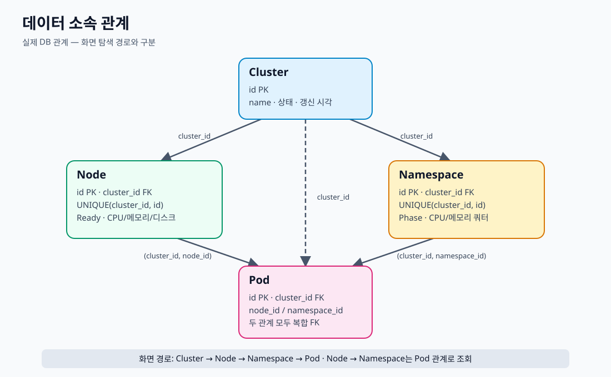

# 데이터 모델

---

## 관계와 화면 경로

- DB에서 Node와 Namespace는 각각 Cluster에 속한다.
- Pod는 Cluster, Node, Namespace를 참조한다.
  두 복합 FK가 세 리소스의 Cluster 일치를 보장한다.
- 화면은 `Cluster → Node → Namespace → Pod` 순서다.
  - Node 아래 Namespace는 **해당 Node의 Pod**에서 찾는다.
  - 같은 Namespace가 여러 Node 아래에 보여도 DB 행은 하나다.
  - Pod 목록은 `node_id`와 `namespace_id`를 함께 제한한다.

모델 선택 이유: [ADR-001](02-adr.md).
실제 DDL: [Flyway V1](../../backend/src/main/resources/db/migration/V1__create_resources.sql),
[검색 인덱스 V2](../../backend/src/main/resources/db/migration/V2__add_trigram_search_indexes.sql).

---

## 테이블

표의 `필수`는 `NOT NULL`, `선택`은 NULL 허용이다.
모든 테이블에서 이름은 고유값이 아니다.

### Cluster (`clusters`)

| 컬럼 | 타입 | 제약 |
| --- | --- | --- |
| `id` | `BIGINT` | PK |
| `name` | `VARCHAR(200)` | 필수 |
| `control_plane_status` | `VARCHAR(48)` | 필수 |
| `kubernetes_version` | `VARCHAR(32)` | 선택 |
| `issue_level` | `VARCHAR(10)` | 필수, CHECK: `NONE` / `WARNING` / `ERROR` / `UNKNOWN` |
| `issue_reason` | `TEXT` | 선택 |
| `last_updated_at` | `TIMESTAMPTZ` | 필수 |

### Node (`nodes`)

| 컬럼 | 타입 | 제약 |
| --- | --- | --- |
| `id` | `BIGINT` | PK |
| `cluster_id` | `BIGINT` | 필수, Cluster FK |
| `name` | `VARCHAR(200)` | 필수 |
| `ready_condition` | `VARCHAR(16)` | 필수, CHECK: `True` / `False` / `Unknown` |
| `cpu_usage_percent` | `NUMERIC(5,2)` | 선택, 0~100 |
| `memory_usage_percent` | `NUMERIC(5,2)` | 선택, 0~100 |
| `disk_usage_percent` | `NUMERIC(5,2)` | 선택, 0~100 |
| `issue_level` | `VARCHAR(10)` | 필수, CHECK: `NONE` / `WARNING` / `ERROR` / `UNKNOWN` |
| `issue_reason` | `TEXT` | 선택 |
| `last_updated_at` | `TIMESTAMPTZ` | 필수 |

- `(cluster_id, id)` UNIQUE:
  Pod의 복합 FK가 참조한다.

### Namespace (`namespaces`)

| 컬럼 | 타입 | 제약 |
| --- | --- | --- |
| `id` | `BIGINT` | PK |
| `cluster_id` | `BIGINT` | 필수, Cluster FK |
| `name` | `VARCHAR(200)` | 필수 |
| `phase` | `VARCHAR(32)` | 필수, CHECK: `Active` / `Terminating` |
| `cpu_quota_used_millicores` | `BIGINT` | 선택, 0 이상 |
| `cpu_quota_limit_millicores` | `BIGINT` | 선택, 0 이상 |
| `memory_quota_used_mib` | `BIGINT` | 선택, 0 이상 |
| `memory_quota_limit_mib` | `BIGINT` | 선택, 0 이상 |
| `issue_level` | `VARCHAR(10)` | 필수, CHECK: `NONE` / `WARNING` / `ERROR` / `UNKNOWN` |
| `issue_reason` | `TEXT` | 선택 |
| `last_updated_at` | `TIMESTAMPTZ` | 필수 |

- `(cluster_id, id)` UNIQUE:
  Pod의 복합 FK가 참조한다.
- Node와 직접 FK로 연결하지 않는다.

### Pod (`pods`)

| 컬럼 | 타입 | 제약 |
| --- | --- | --- |
| `id` | `BIGINT` | PK |
| `cluster_id` | `BIGINT` | 필수, Cluster FK |
| `namespace_id` | `BIGINT` | 필수, Namespace 복합 FK |
| `node_id` | `BIGINT` | 필수, Node 복합 FK |
| `name` | `VARCHAR(200)` | 필수 |
| `phase` | `VARCHAR(32)` | 필수, CHECK: `Pending` / `Running` / `Succeeded` / `Failed` / `Unknown` |
| `ready` | `BOOLEAN` | 선택 |
| `restart_count` | `INTEGER` | 필수, 0 이상 |
| `cpu_usage_millicores` | `BIGINT` | 선택, 0 이상 |
| `memory_usage_mib` | `BIGINT` | 선택, 0 이상 |
| `issue_level` | `VARCHAR(10)` | 필수, CHECK: `NONE` / `WARNING` / `ERROR` / `UNKNOWN` |
| `issue_reason` | `TEXT` | 선택 |
| `last_updated_at` | `TIMESTAMPTZ` | 필수 |

- `(cluster_id, node_id)` → Node의 `(cluster_id, id)`.
- `(cluster_id, namespace_id)` → Namespace의 `(cluster_id, id)`.
- 초기 Mock에서는 모든 Pod에 Node를 배정한다.
- 모든 Namespace는 Pod가 1개 이상 있어야 화면 경로를 가진다.
  Pod가 없는 Namespace는 트리와 검색 결과에 나타나지 않고, 상세는 경로가 없어 `404`다.
  시드는 모든 Namespace에 Pod를 둔다.

V1은 삭제 시 `CASCADE`를 지정하지 않는다.

---

## 조회와 인덱스

- Cluster의 Node: `nodes.cluster_id`.
- Node의 Namespace: 해당 Node의 Pod에서 중복 제거.
- Node, Namespace의 Pod: 두 ID를 모두 조건으로 조회.
- V1 B-tree
  - `nodes(cluster_id, name, id)`
  - `namespaces(cluster_id, name, id)`
  - `pods(node_id, namespace_id, name, id)`
- V2 `pg_trgm` GIN
  - `lower(namespaces.name)`
  - `lower(pods.name)`
  - 3자 이상 부분 검색에 사용한다.

측정 결과와 남은 병목:
[API/DB 성능 보고서](../report/03-server-performance.md).

---

## Mock 데이터

- [기본 시드](../../scripts/seed.sql):
  Cluster 20 / Node 200 / Namespace 2,000 / Pod 100,000건.
  결정적인 ID, 이름을 사용하고 기존 ID는 건너뛴다.
- [검증 SQL](../../scripts/verify.sql):
  행 수, 관계, 검색 경계를 확인한다.
- [공유 Namespace 시드](../../scripts/seed-shared-namespace.sql):
  여러 Node가 한 Namespace를 쓰는 경계 데이터다.
  전용 테스트 DB에서만 적용한다.
