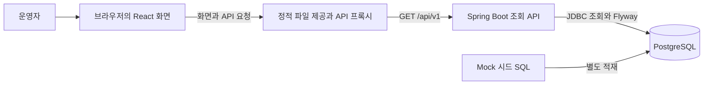
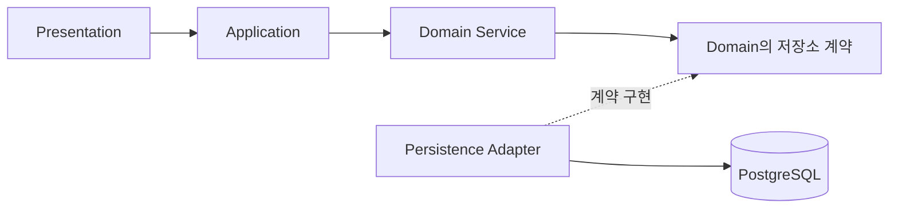
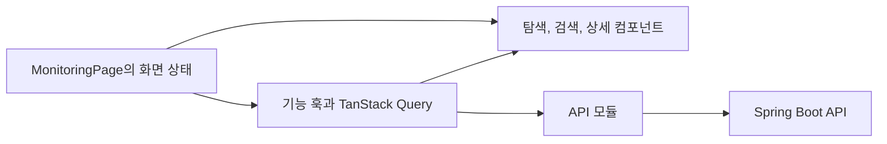

# 시스템 아키텍처

이 서비스는 PostgreSQL에 저장한 Mock Kubernetes 리소스를 탐색하고 상태를 확인하는 조회 서비스다. 실제 Kubernetes API와 연결하지 않는다. 외부에서 데이터를 수집하는 기능도 현재 범위에 없다.

## 시스템 경계와 실행 구성

| 실행 방식 | 정적 파일과 프록시 | 백엔드와 DB |
| --- | --- | --- |
| 개발 | Vite 개발 서버 | 로컬 Spring Boot, Docker PostgreSQL |
| 컨테이너 | nginx 이미지 | Spring Boot 이미지, PostgreSQL 컨테이너 |

브라우저의 API 요청은 프록시를 거쳐 백엔드로 간다. 백엔드는 조회용 GET만 제공한다. Flyway는 기동 시 스키마를 관리하고 Mock 시드는 별도 명령으로 적재한다. 실행 명령은 [README](../../README.md)에 있다.

## 구성 요소의 책임

| 구성 요소 | 책임 | 경계 |
| --- | --- | --- |
| React 화면 | 탐색 위치, 검색어, 필터, 선택 상태와 영역별 로딩 및 오류 표시 | 리소스 전체를 브라우저에 적재하지 않음 |
| TanStack Query | 서버 응답 캐시, 활성 조회의 재요청, 오래된 응답 격리 | 사용자 선택 상태를 소유하지 않음 |
| Spring Boot API | 입력 검증, 읽기 전용 조회 흐름, 응답 시각과 오류 변환 | 화면 상태를 저장하지 않음 |
| Domain | 리소스 관계와 경로 규칙, 상태와 심각도 의미 | HTTP 형식과 SQL을 알지 않음 |
| Persistence | 저장소 계약 구현, 필터와 페이지를 DB 쿼리로 처리 | 사용자 화면 규칙을 판단하지 않음 |
| PostgreSQL | 리소스 관계 제약, 검색과 필터, 대량 데이터 보관 | 실시간 Kubernetes 상태를 수집하지 않음 |

데이터 관계는 [데이터 모델](03-data-model.md), HTTP 형식은 [OpenAPI](openapi.yaml)가 기준이다. 선택한 방식과 비용은 [ADR](02-adr.md)에 기록한다.

## 백엔드 의존 방향

- Presentation은 HTTP 입력을 검사하고 Application에 전달한 뒤 응답으로 변환한다.
- Application은 읽기 전용 트랜잭션과 조회 시각 `fetchedAt`을 관리한다.
- Domain은 관계와 경로의 유효성을 판단한다. 저장소 계약은 Domain에 속한다.
- Persistence Adapter는 JPA, QueryDSL, 검색 SQL로 계약을 구현한다. Domain에서 Infrastructure로 직접 의존하지 않는다.
- 공통 오류 처리는 예외를 [API 오류 계약](04-api-spec.md#오류)의 HTTP 응답으로 바꾼다.

계층별 구체적인 구현 규칙은 [Backend AGENTS](../../backend/AGENTS.md)에 둔다.

## 프론트엔드 데이터 흐름

`app → pages → features → shared` 방향으로 의존한다. 페이지는 검색어, 필터, 펼침, 선택을 소유한다. 기능 훅은 TanStack Query로 서버 응답을 읽고, 컴포넌트는 결과와 이벤트를 표시한다. API 모듈은 GET 요청과 응답 변환을 맡는다.

서버 응답과 화면 선택을 분리하므로 재조회가 검색어, 필터, 펼침, 선택을 초기화하지 않는다. 프론트엔드의 폴더와 상태 소유 규칙은 [Frontend AGENTS](../../frontend/AGENTS.md)에 둔다.

## 대표 조회 흐름

Node를 펼치는 경우 다음 순서로 진행한다.

1. 화면은 펼친 Node의 직접 하위 Namespace만 요청한다.
2. API는 입력과 Node 존재를 확인하고, Domain의 저장소 계약을 통해 조회한다.
3. Persistence는 해당 Node에 Pod가 있는 Namespace를 중복 없이 DB에서 찾는다.
4. API는 목록과 성공 조회 시각 `fetchedAt`을 반환한다.
5. 화면은 새 결과로 보이는 행만 다시 그린다. Namespace의 Pod는 그 Namespace를 펼칠 때 조회한다.

검색은 열린 트리와 관계없이 DB의 네 리소스를 대상으로 한다. 필터와 검색어는 DB에서 함께 처리하고, 결과의 경로 정보로 필요한 트리 분기만 연다.

## 변경 시 확인할 경계

- Namespace는 Cluster에 속한다. 화면의 Node 아래 경로는 Pod 관계에서 나온다. 같은 Namespace가 여러 Node 아래 나타날 수 있다.
- 상태 코드와 이상 심각도는 별개다. 자식의 이상으로 부모의 고유 상태를 바꾸지 않는다.
- 대량 검색과 필터는 DB에서 처리한다. 모든 Pod를 Java 메모리나 DOM에 한꺼번에 올리지 않는다.
- 30초 폴링과 수동 갱신은 현재 표시 중인 GET을 다시 호출한다. 실패해도 이전 성공 데이터와 탐색 위치를 유지한다.
- ERD 또는 API 계약 변경이 필요하면 영향 범위를 먼저 보고하고, 중요한 결정은 사용자 확인 후 ADR에 남긴다.

관련 기능의 기대 결과는 [테스트 시나리오](06-test-scenarios.md), 실제 검증 결과는 `docs/report/`에서 확인한다.
